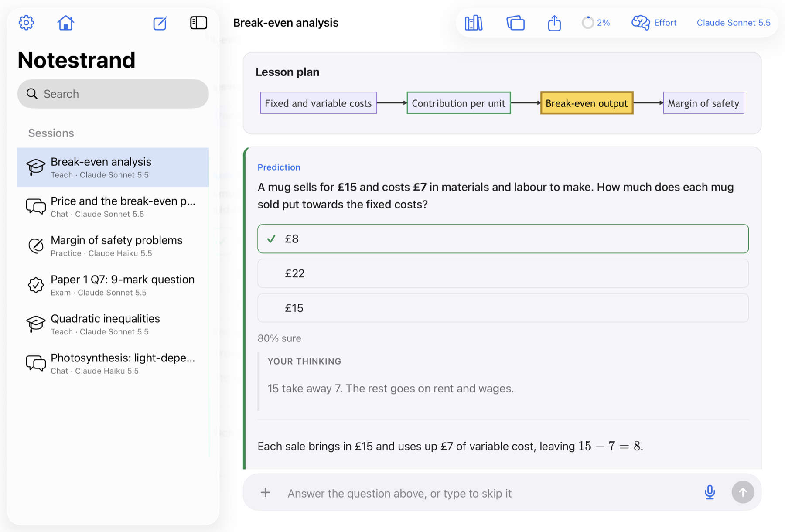
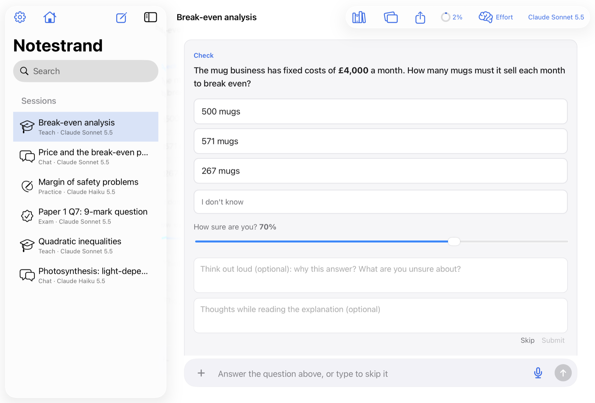
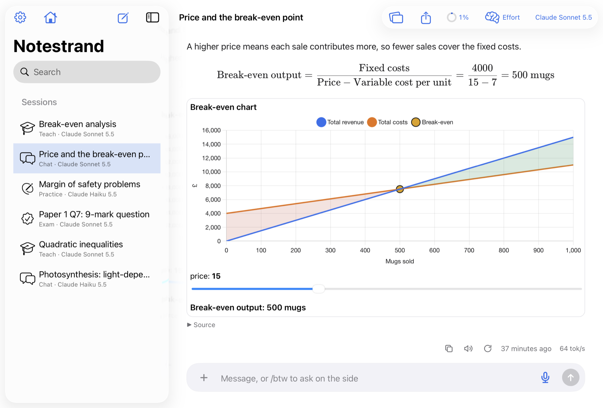
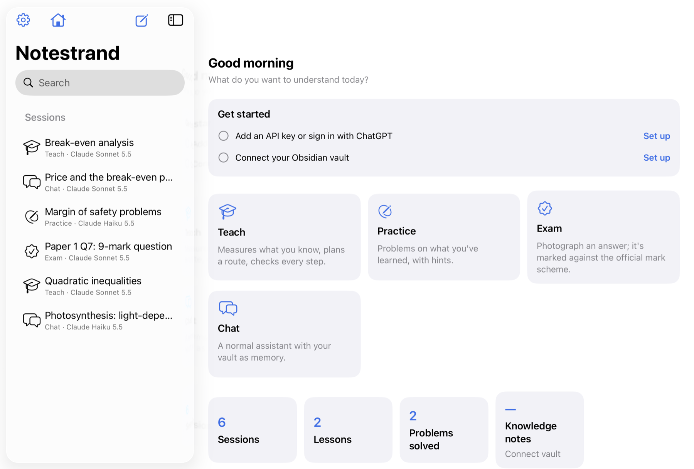

<div align="center">


# Notestrand

**An AI tutor for iPads stuck on iOS 15.**

It teaches, sets practice problems, marks exam answers and chats,<br>
using your own AI accounts and your Obsidian vault as its memory.


</div>

Most AI apps now need a newer iOS, so an older iPad is left without one. Notestrand is a native SwiftUI app written for that iPad: it targets iOS 15, installs with [TrollStore](https://github.com/opa334/TrollStore), and talks straight to the AI provider you choose. There is no Notestrand account and no server in between.

Its teaching method and prompts come from [LearnHarness](https://github.com/amosblomqvist/learnharness): it finds out what you already know, plans a route to what you want to understand, and checks each step before moving on.

<table>
  <tr>
    <td width="50%"></td>
    <td width="50%"></td>
  </tr>
  <tr>
    <td><b>Teach.</b> The lesson plan shows where you are, and every answer gets feedback.</td>
    <td><b>Question cards.</b> Pick an answer, say how sure you are, and think out loud.</td>
  </tr>
  <tr>
    <td></td>
    <td></td>
  </tr>
  <tr>
    <td><b>Visuals.</b> Formulas, diagrams and charts you can drag.</td>
    <td><b>Home.</b> Four modes, your stats and recent sessions.</td>
  </tr>
</table>

<sub>The app showing sample conversations, captured on the iPadOS 26 simulator. On iOS 15 the toolbars and sidebar have the older system look.</sub>

## Contents

- [Modes](#modes)
- [Features](#features)
- [Requirements](#requirements)
- [Install](#install)
- [Connect an AI account](#connect-an-ai-account)
- [Connect your Obsidian vault](#connect-your-obsidian-vault)
- [Privacy and safety](#privacy-and-safety)
- [Build from source](#build-from-source)
- [Development](#development)
- [Status](#status)
- [Credits](#credits)
- [License](#license)

## Modes

| Mode | What it does |
| --- | --- |
| **Teach** | Asks a few graded questions to find what you already know, plans a route to your goal, shows it as a lesson plan diagram, and checks every step before the next one. |
| **Practice** | Sets problems on what you've learned, gives hints when you're stuck, then shows a verdict and the model solution. |
| **Exam** | You photograph an exam question and the answer you wrote. It transcribes both, looks for the official mark scheme in your notes and on the web, and marks your answer against it. |
| **Chat** | A normal assistant that can search the web and read your notes, and names its sources. |

## Features

**Learning**

- **Question cards** with a confidence slider and a "think out loud" box. They are marked on the iPad, and the explanation appears after you answer.
- **A live lesson plan**: a diagram of the route, with the step you're on highlighted.
- **Flashcards**: make cards from any chat and review them with spaced repetition.
- **Knowledge carry-over**: "Save to knowledge" writes what a Teach session covered as linked notes in your vault. Later sessions start from them, and Obsidian's graph view becomes your knowledge graph.

**Your notes as memory**

- The AI can search and read the notes in your Obsidian vault.
- `Notestrand/Memory.md` is loaded into every conversation. You can read and edit it in Settings.
- Chats can be saved to the vault, or shared as Markdown or PDF.

**Visuals**

- Maths set with KaTeX, and diagrams drawn with Mermaid (common syntax slips are repaired automatically).
- Interactive charts with sliders, drawn with a bundled Chart.js.
- Live HTML demos in a sandboxed frame, with no network and no access to the app.

**In every chat**

- Attach photos (library or camera), PDFs and text files, or dictate your message.
- **Share to Notestrand** from other apps: up to four photos, a link or text.
- Web search and page reading, which you can turn off. Search works without a key (DuckDuckGo), or with your own Tavily, Brave or Firecrawl key.
- Edit and resend, regenerate, or branch from an earlier message.
- `/btw` asks a side question that stays out of the chat. Quick prompts such as `/explain` and `/quiz` are editable.
- Read aloud, copy, and a context meter that shows how full the model's context window is.
- Reply speed in tokens per second, a reasoning effort setting, and fast mode on models that support it.
- Projects, pins, rename and search in the sidebar.

**Personalisation**

- Your name, pronouns and level of study (GCSE, A-level, university…).
- Tutor tone (balanced, encouraging or direct), reply length, and British or American spelling.
- Custom instructions added to every conversation.
- Theme, accent colour, text size and haptics.

## Requirements

- An iPad on iOS 15.0 or later with [TrollStore](https://github.com/opa334/TrollStore) installed. TrollStore only works on certain iOS versions; its README lists them.
- At least one AI account: an API key, or a ChatGPT Plus or Pro plan (see [below](#connect-an-ai-account)).
- Optional: an [Obsidian](https://obsidian.md) vault, in iCloud Drive or on the iPad.
- To build it yourself: a Mac with Xcode, [XcodeGen](https://github.com/yonaskolb/XcodeGen) and `ldid`.

Notestrand is iPad-only and isn't on the App Store. The build is fake-signed for TrollStore, and other sideloading tools haven't been tested.

## Install

1. Get `Notestrand.tipa`: download it from [Releases](https://github.com/footfungus2/Notestrand/releases) when one is published, or [build it](#build-from-source).
2. Send it to the iPad with AirDrop or the Files app.
3. Open it with TrollStore and tap **Install**.
4. Open Notestrand and follow the welcome walkthrough. It covers the modes, your AI account, your name and your vault, and every step can be skipped. You can replay it from Settings → About → Welcome and setup.

## Connect an AI account

You bring your own account, and requests go from the iPad straight to that provider. Add keys in Settings → API keys.

| Provider | Where to get a key | Notes |
| --- | --- | --- |
| Anthropic (Claude) | [console.anthropic.com](https://console.anthropic.com/settings/keys) | Prompt caching is on, which keeps long lessons cheaper. |
| OpenAI | [platform.openai.com](https://platform.openai.com/api-keys) | An API key. This is separate from a ChatGPT subscription. |
| Google Gemini | [aistudio.google.com](https://aistudio.google.com/apikey) | Uses Google's OpenAI-compatible endpoint. |
| OpenRouter | [openrouter.ai](https://openrouter.ai/keys) | One key for models from many vendors. |
| OpenCode Zen | [opencode.ai](https://opencode.ai/zen) | Shows the models that use the Anthropic or Chat Completions format; the rest are hidden. |
| ChatGPT plan | Settings → ChatGPT plan → Continue with ChatGPT | Uses your Plus or Pro allowance instead of an API key. |

**If the ChatGPT login page won't load.** iOS 15's built-in browser is too old for some login pages. Tap **Sign in with Reynard instead** to finish the login in [Reynard](https://github.com/minh-ton/reynard-browser), a Gecko-based browser for TrollStore devices, then return to Notestrand. If the app doesn't pick the sign-in up by itself, copy the final address from Reynard and tap **Paste sign-in link**.

There is also a setting to open links from chats in Reynard: Settings → Appearance → Open links in Reynard.

## Connect your Obsidian vault

In Settings → Obsidian vault, tap **Choose vault folder** and pick your vault, for example `iCloud Drive/Obsidian/<vault>`.

Then choose the access level:

- **Read only**: the AI can search and read your notes, and never creates or changes anything.
- **Read & write**: the AI can also create and edit notes, but only inside the vault's `Notestrand/` folder. That is where `Memory.md`, saved knowledge and exported chats go. Your existing notes are never modified.

AI makes mistakes, so keep a backup of your vault (Obsidian Sync, iCloud or Git) if you allow writing.

## Privacy and safety

- **No account, no server, no analytics.** The app only contacts the AI provider you pick, the search provider you pick, the web pages the AI opens for you, and OpenAI's sign-in if you use the ChatGPT plan.
- **Your conversations go to the AI provider you choose**, including any notes or web pages the AI reads during them. That provider's privacy policy applies.
- **Keys and tokens are stored in the iOS Keychain.** If the Keychain isn't available under TrollStore, they go in a file with complete data protection instead. They are never written to chats, logs or prompts.
- **Chats and flashcards stay on the iPad**, in the app's own storage.
- **Vault access is limited to the folder you choose.** The AI can read only Markdown notes there. Hidden folders such as `.obsidian` are off limits, because plugin settings can hold keys.
- **Model output can't make network requests.** The conversation view is network-blocked, and demos run in sandboxed frames.
- **Web reading refuses private and local network addresses**, including through redirects.
- **Web pages can contain misleading instructions** aimed at the AI. Turn web access off in Settings for private work.

## Build from source

```sh
brew install xcodegen ldid
git clone https://github.com/footfungus2/Notestrand.git
cd Notestrand
./build.sh            # → build/Notestrand.tipa
```

`build.sh` generates the Xcode project from `project.yml`, makes an unsigned Release build, fake-signs the share extension and the app with `ldid` using the entitlements in the repository, and zips the result into a `.tipa`.

## Development

```sh
xcodegen generate     # the .xcodeproj is generated; edit project.yml instead
open Notestrand.xcodeproj
xcodebuild test -project Notestrand.xcodeproj -scheme Notestrand \
  -destination 'platform=iOS Simulator,name=<an iPad simulator>'
```

The tests run on a simulator with iOS 17 or later; the app itself still targets iOS 15. Tests that call a real AI provider are skipped unless you pass a key:

```sh
TEST_RUNNER_OPENROUTER_API_KEY=… xcodebuild test … -only-testing:NotestrandTests/LiveTests
```

**iOS 15 is the hard part.** The project has no iOS 15 simulator to test on, so iOS 15 behaviour is only proven on a real iPad, and the compiler doesn't catch everything that breaks there: newer SF Symbols draw blank, newer JavaScript and CSS stop the conversation view, and a newer Swift runtime library crashes the app at launch. [`AGENTS.md`](AGENTS.md) lists these pitfalls, how to check for each, and the project's conventions. Please read it before you change anything.

### How it's put together

| Path | What it is |
| --- | --- |
| `Notestrand/Agent.swift` | App state and the turn loop: stream a reply, run tools, pause on question cards, hand off from assessment to teaching |
| `Notestrand/LLMClient.swift` | Request bodies and stream parsers for three wire formats: Anthropic Messages, OpenAI Chat Completions, OpenAI Responses |
| `Notestrand/Providers.swift` | Provider endpoints, the Keychain store, the model catalogue |
| `Notestrand/ChatGPTAuth.swift` | Sign in with ChatGPT: OAuth with PKCE, a loopback callback, the Reynard route, token refresh |
| `Notestrand/Tools.swift`, `Resources/tools.json` | Prompt assembly and tool schemas for each mode |
| `Notestrand/Resources/prompts/` | LearnHarness's prompt fragments, unchanged, plus this app's own (`shared/90-ipad.md`, `examiner/`) |
| `Notestrand/Vault.swift` | Vault bookmark, search and read, the single confined write path, knowledge notes |
| `Notestrand/WebTools.swift` | `web_search` and `web_fetch`, with the checks that refuse private addresses |
| `Notestrand/ChatView.swift` | The chat screen, composer, attachments, export, and the bridge to the conversation view |
| `Notestrand/Resources/web/` | The conversation view, a local web page: Markdown, KaTeX, Mermaid, charts, demos, question cards |
| `ShareExtension/` | "Share to Notestrand" |
| `Tests/` | Unit tests, including ones that run the conversation page in a real web view |

### Contributing

Issues and pull requests are welcome. For a pull request:

- run the tests,
- keep every change working on iOS 15 (see `AGENTS.md`), and
- say what you could and couldn't check on a real device.

## Status

Version 0.1.0. Notestrand is developed and used on one iPad running iOS 15.3.1. Other iPads and iOS versions are untested, so please open an issue if something breaks on yours.

## Credits

- Teaching method, prompts and tool schemas: [LearnHarness](https://github.com/amosblomqvist/learnharness) (AGPL-3.0).
- Bundled in `Notestrand/Resources/web/vendor/`, all MIT-licensed: [markdown-it](https://github.com/markdown-it/markdown-it) 13.0.2, [markdown-it-texmath](https://github.com/goessner/markdown-it-texmath), [KaTeX](https://github.com/KaTeX/KaTeX) 0.16.9, [Mermaid](https://github.com/mermaid-js/mermaid) 9 and [Chart.js](https://github.com/chartjs/Chart.js) 4.4.1.
- Provider logos: [LobeHub Icons](https://github.com/lobehub/lobe-icons) (MIT).
- Installing on iOS 15 is possible thanks to [TrollStore](https://github.com/opa334/TrollStore). The alternative sign-in route uses [Reynard](https://github.com/minh-ton/reynard-browser).

Notestrand is an independent project. It isn't affiliated with or endorsed by Anthropic, OpenAI, Google, OpenRouter, OpenCode, Obsidian or LearnHarness. Their names and logos belong to their owners and are used only to identify the services you connect.

## License

[AGPL-3.0](LICENSE), inherited from the LearnHarness prompts and teaching method bundled in the app. If you share a build of Notestrand, you must make its source available under the same licence.
